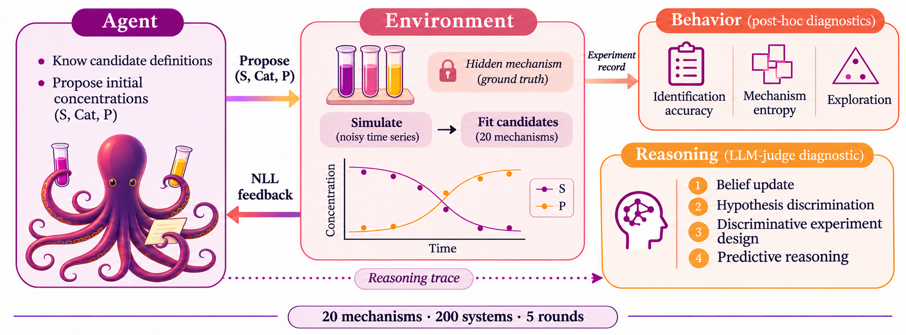

# Beyond Accuracy: A Diagnostic Benchmark for Hypothesis-Driven Experiment Planning in LLM Agents

This benchmark evaluates how LLM agents plan experiments to identify hidden kinetic mechanisms. Alongside task accuracy, it measures exploration behavior and diagnoses four reasoning capabilities: belief update, hypothesis discrimination, discriminative experiment design, and predictive reasoning.

This repository contains the benchmark implementation, 20 COPASI mechanisms, 200 sampled systems, and LLM/expert judgments used in the paper. [Paper (OpenReview)](https://openreview.net/forum?id=VZAGnyBRvm) · [PDF](https://openreview.net/pdf?id=VZAGnyBRvm)

## Use the benchmark

Follow [Run and evaluate your own experiments](docs/run_experiments.md): install dependencies, run an LLM agent or baseline, generate the main figure types for your runs, and evaluate the agent's reasoning with an LLM judge.

## Paper data and results

The LLM judge scores and expert ratings used in the paper are included in this repository. See [Paper data and results](docs/reproduce.md) for available analysis data, their mapping to paper figures and tables, and reproduction commands. Analyses of the saved judgments require no LLM API calls.

## Citation and license

Please cite Ryo Kuroki, Amin Mansouri, and Philippe Schwaller, **Beyond Accuracy: A Diagnostic Benchmark for Hypothesis-Driven Experiment Planning in LLM Agents**, NeurIPS 2026. Machine-readable citation details are in [CITATION.cff](CITATION.cff).

The [public dataset](https://huggingface.co/datasets/xq8wvm/HypothesisDrivenExperimentPlanningBench) contains the 200 synthetic systems and validated Croissant metadata. See [provenance and attribution](docs/provenance.md) for the mechanism source, generated data, and software dependencies.

Released under [CC-BY-4.0](LICENSE).
